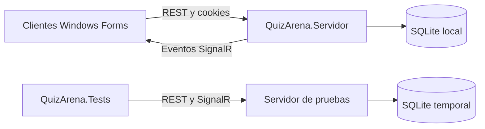

# BORRADOR-PROYECTO-SIST

## Quiz Arena — fase 8: CRUD, administración y validación final

Solución C# para Visual Studio 2026 y **.NET 10**, con una API REST en
`http://localhost:5080`, una base de datos SQLite y varias instancias WinForms.
Cada ventana puede acceder con una cuenta distinta y mantiene sus propias cookies.

La fase 2.3 incorpora 100 preguntas al banco inicial de 12. La fase 3 añade
registro con contraseña, inicio de sesión, consulta del perfil y cierre de sesión.
La fase 4 incorpora salas de espera compartidas, públicas o privadas, con
configuración del anfitrión, control de aforo y estado de preparación.
La fase 5 permite completar partidas individuales con preguntas compartidas,
plazos oficiales, respuestas definitivas, puntuaciones y clasificación final.
La fase 6 abre automáticamente la partida en todos los clientes y añade equipos
de dos o tres integrantes, votos provisionales y confirmación por unanimidad.

## Fase 8: cuentas, administración e historial

La solución de entrega contiene tres proyectos: `QuizArena.Servidor` (ASP.NET
Core REST, SignalR y SQLite), `QuizArena.Cliente` (Windows Forms) y
`QuizArena.Tests` (xUnit). Se ejecuta en un único ordenador con .NET 10 y Visual
Studio 2026. Los clientes mantienen sesiones independientes. El servidor calcula
puntos, valida permisos y coordina las operaciones concurrentes; WinForms consume
HTTP y las notificaciones SignalR.



### Arranque y Swagger

Desde la carpeta de la solución:

```powershell
dotnet restore QuizArena.sln
dotnet build QuizArena.sln
dotnet run --project QuizArena.Servidor --launch-profile http
```

El arranque aplica las migraciones pendientes sin recrear la base. El perfil
`http` escucha en **localhost:5080 y localhost:5162**. Ejecutar después
`QuizArena.Cliente.exe` o seleccionar el perfil de inicio de servidor y cliente
en Visual Studio. Para cuatro jugadores, abrir cuatro procesos del cliente.

Swagger: <http://localhost:5162/swagger/index.html>. También está disponible en
el puerto 5080. `/swagger` redirige a `/swagger/index.html` y el documento es
`/openapi/v1.json`. Las descripciones distinguen operaciones públicas, con sesión
y exclusivas de Administrador. Iniciar sesión mediante `/api/acceso/entrar` en
Swagger permite utilizar su cookie en las operaciones protegidas.

La interfaz Swagger carga sus recursos desde unpkg y necesita conexión a
Internet; la API REST, SignalR, SQLite y los clientes funcionan localmente.

SQLite utiliza `QuizArena.Servidor/quizarena.db` por defecto. Para otra base:

```powershell
$env:BaseDatos__Ruta = 'C:\Ruta\BaseSeparada.db'
dotnet run --project QuizArena.Servidor --launch-profile http
Remove-Item Env:\BaseDatos__Ruta
```

Las pruebas xUnit fijan automáticamente una ruta temporal única **antes** de
construir el servidor y comprueban esa ruta. No utilizan los datos reales.
Un clon nuevo necesita importar los bancos JSON siguiendo la sección de
importación de este README; los usuarios locales se registran desde el cliente.

### Cuenta y permisos

`PerfilForm`, accesible desde «Ver mi perfil», permite cambiar nombre y
contraseña y eliminar la propia cuenta, comprobando la contraseña actual.
La baja exige abandonar cualquier sala, anonimiza el registro y conserva su Id y
sus resultados. Tras el HTTP 204, el cliente vuelve a la pantalla de acceso.
Se reserva el prefijo `BAJA_`. El antiguo `POST /api/jugadores` devuelve 410;
el registro con contraseña se hace mediante `/api/acceso/registrar`.

Cada petición autenticada valida que la cuenta siga activa y actualiza el nombre
y el rol de su cookie. Los métodos sensibles del Hub comprueban también `Activo`
para conexiones persistentes. Las operaciones administrativas exigen el rol en
el servidor. `GET /api/cuenta` solo revela el indicador administrativo de la
propia cuenta; los listados públicos no incluyen contraseñas ni hashes.

Para habilitar al primer administrador, registrar una cuenta con contraseña
propia, detener el servidor y ejecutar localmente:

```powershell
dotnet run --project QuizArena.Servidor -- --hacer-admin=TU_USUARIO
```

Sustituir `TU_USUARIO` por el nombre registrado. El comando valida que exista una
cuenta activa con contraseña, actualiza su rol y termina sin iniciar el servidor.
No existe un endpoint público de promoción ni una contraseña administrativa
fija. Al volver a arrancar, el botón «Administración» se habilita para esa cuenta.
La validación probó este procedimiento con una cuenta de una base temporal.
La activación de una cuenta administradora en la base real queda como operación
local del propietario; no se ha modificado el rol de sus cuentas existentes.

### Endpoints de la fase 8

| Método | Ruta | Permiso y comportamiento |
| --- | --- | --- |
| GET | `/api/cuenta` | Propia cuenta activa, incluido `esAdministrador` |
| PUT | `/api/cuenta` | Nombre nuevo y contraseña actual; 409 si está ocupado |
| PUT | `/api/cuenta/clave` | Contraseñas actual y nueva; 204 |
| DELETE | `/api/cuenta` | JSON `claveActual`; baja lógica, 409 si está en sala |
| GET | `/api/categorias/{id}` | Consulta pública; 404 si no existe |
| POST / PUT | `/api/categorias` / `/api/categorias/{id}` | Administrador; alta 201, edición 200 |
| DELETE | `/api/categorias/{id}` | Administrador; 204 solo si no tiene preguntas ni salas |
| GET | `/api/preguntas/admin` | Administrador; incluye inactivas, solución, fuente y licencia; `pagina`/`tamano` |
| GET | `/api/preguntas/admin/{id}` | Administrador; detalle para edición |
| POST | `/api/preguntas` | Administrador; valida categoría, opciones y enunciado único; 201 |
| PUT | `/api/preguntas/{id}` | Administrador; 409 si la pregunta ya tiene historial |
| DELETE | `/api/preguntas/{id}` | Administrador; desactiva sin eliminar la fila |
| PUT | `/api/preguntas/{id}/activar` | Administrador; reactiva una pregunta existente |
| DELETE | `/api/salas/{codigo}` | Anfitrión; 409 durante una partida; conserva historiales |
| PUT | `/api/chat/mensajes/{id}` | Solo autor; texto de 1–250 caracteres |
| DELETE | `/api/chat/mensajes/{id}` | Solo autor; sustituye el texto por `[Mensaje eliminado]` |
| GET | `/api/partidas/historial` | Partidas finalizadas del jugador autenticado |
| GET | `/api/partidas/{id}/resumen` | Solo participantes; resultado, jugadores y equipos |

Las operaciones nuevas se añaden a las rutas anteriores de acceso, salas,
partidas, equipos, clasificaciones y preguntas públicas descritas más abajo.
Los GET públicos de preguntas siguen sin revelar soluciones. Los errores de
validación devuelven 400, los recursos inexistentes 404, los conflictos 409 y
las solicitudes sin sesión o permisos 401/403.

### Reglas de integridad y concurrencia

- Cuentas: desactivación, anonimización y retirada de credenciales; resultados
  conservados y cookies antiguas rechazadas.
- Preguntas: DELETE desactiva; el motor solo selecciona activas para nuevas
  partidas. Una pregunta ya asignada no se edita: se desactiva y se crea otra
  versión. Importador y API comparten `ValidadorPreguntas`.
- Categorías: borrado físico solo sin referencias, incluso preguntas inactivas.
- Salas: solo el anfitrión cancela; se retiran participantes y se conserva la
  sala si tiene partidas. Sin historial se elimina físicamente.
- Mensajes: solo su autor edita o elimina. DELETE retira el contenido original
  manteniendo las relaciones; un mensaje eliminado no admite edición posterior.
- Partidas y respuestas definitivas: sin endpoints para modificar puntos ni
  eliminar resultados. El historial distingue el modo de cada partida por sus
  asignaciones históricas y muestra los puntos del equipo cuando corresponde.

El mismo `CoordinadorSalas` serializa inicios, cambios del banco, cancelaciones,
chat y bajas de cuenta. Las comprobaciones de pertenencia se realizan dentro
del bloqueo en las mutaciones de sala. Los índices únicos resuelven también
nombres y enunciados duplicados. El supervisor mantiene los plazos oficiales.

`ChatActualizado` avisa de una edición o eliminación sin transportar el texto.
El cliente recupera su historial autorizado mediante REST; las notificaciones
privadas se limitan a destinatarios del equipo y miembros activos de la sala.
El chat conserva la selección y el borrador al refrescar. Se mantienen el límite
de mensajes de un segundo y las **reacciones consecutivas sin espera de dos
segundos**, conforme a la petición del usuario.

`AdministracionForm` contiene pestañas de categorías y preguntas, edición,
desactivación y reactivación. `HistorialForm` ofrece consulta de resultados sin
botones para modificar puntuaciones. Los formularios utilizan el mismo cliente
HTTP autenticado. El podio individual se conserva; el podio de equipos utiliza
su marcador real e identifica los empates.

### Migraciones y pruebas

- `20261126150616_AdministracionJugadores`: añade `Activo` (valor predeterminado
  true), `EsAdministrador` (false) y `EliminadoUtc` a los jugadores existentes.
- `20261126150755_EdicionMensajes`: añade `Eliminado` y `EditadoUtc` al chat.

Ambas migraciones se revisaron y aplicaron. Hay diez en total y el modelo EF
no tiene cambios pendientes. Los respaldos locales se guardaron fuera de Git.

```powershell
dotnet test QuizArena.sln
```

**19 casos xUnit superados**, sin omisiones. Cubren cuentas, cookies, roles,
categorías, preguntas y validación compartida, privacidad de chat con SignalR
real, edición y borrado, reacciones seguidas, aforo concurrente, respuestas
simultáneas, puntuación por rapidez, equipos de dos y tres miembros, decisiones
irreversibles, vencimientos, supervisor sin sondeo, revancha, historial, Swagger
y conservación de resultados. Todas sus escrituras y bajas usan SQLite temporal.

La validación WinForms utilizó cuatro procesos independientes sobre `visual.db`:
altas y edición de categorías, alta de pregunta, cambio de nombre, edición de
chat propio, entrada automática y partida individual, equipos, revancha e
historial después de reiniciar. Se observaron resultados individuales 1048–821,
equipos 650–650 y revancha 1200–1200. La preparación de salas y parte de las
respuestas, votos y confirmaciones se apoyaron en REST. Los cambios de contraseña,
bajas de cuenta y permisos de borrado se verificaron automáticamente; no se
presentan como una secuencia manual completa de esos botones.

Los nuevos diseñadores de perfil, administración e historial se abrieron en
Visual Studio. Compilación: **0 errores y 0 advertencias**. El código de pruebas,
formularios y migraciones forma parte de la solución. SQLite, archivos privados,
`bin`, `obj` y configuración local de Visual Studio se mantienen excluidos.

Guion de presentación: [DEMO-FASE8.md](DEMO-FASE8.md).
Estado de entrega y continuación: [CONTINUAR-FASE8.md](CONTINUAR-FASE8.md).

```text
QuizArena.sln
├── QuizArena.Servidor
│   ├── Program.cs
│   ├── Controllers/
│   │   ├── EstadoController.cs
│   │   ├── JugadoresController.cs
│   │   ├── CategoriasController.cs
│   │   ├── PreguntasController.cs
│   │   ├── AccesoController.cs
│   │   ├── SalasController.cs
│   │   ├── PartidasController.cs
│   │   └── EquiposController.cs
│   ├── Data/
│   │   ├── QuizArenaDbContext.cs
│   │   └── ImportadorPreguntas.cs
│   ├── Models/
│   │   ├── Jugador.cs
│   │   ├── Categoria.cs
│   │   ├── Pregunta.cs
│   │   ├── DificultadPregunta.cs
│   │   ├── Sala.cs
│   │   ├── ParticipanteSala.cs
│   │   ├── ModalidadSala.cs
│   │   ├── EstadoSala.cs
│   │   ├── FasePartida.cs
│   │   ├── Partida.cs
│   │   ├── PartidaPregunta.cs
│   │   ├── PartidaJugador.cs
│   │   ├── RespuestaPartida.cs
│   │   ├── EquipoPartida.cs
│   │   ├── VotoEquipo.cs
│   │   └── RespuestaEquipo.cs
│   ├── DTOs/
│   │   ├── CrearJugadorDto.cs
│   │   ├── JugadorRespuestaDto.cs
│   │   ├── CredencialesDto.cs
│   │   ├── PreguntaImportacionDto.cs
│   │   ├── PreguntaPublicaDto.cs
│   │   ├── SalasDto.cs
│   │   ├── PartidasDto.cs
│   │   └── ConfirmarEquipoDto.cs
│   ├── Services/
│   │   ├── CoordinadorSalas.cs
│   │   ├── MotorPartidas.cs
│   │   └── MotorEquipos.cs
│   ├── Datos/
│   │   ├── preguntas.json
│   │   └── preguntas_trivial_100_quizarena.json   Banco propio incluido en Git
│   ├── Migrations/
│   └── Properties/launchSettings.json
└── QuizArena.Cliente
    ├── Program.cs
    ├── PerfilJugador.cs
    ├── Models/SalasApi.cs
    ├── Models/PartidasApi.cs
    ├── Form1.cs
    ├── Form1.Designer.cs
    ├── Form1.resx
    ├── SalasForm.cs
    ├── SalasForm.Designer.cs
    ├── SalasForm.resx
    ├── PartidaForm.cs
    ├── PartidaForm.Designer.cs
    └── PartidaForm.resx
```

El servidor mantiene las referencias directas a
`Microsoft.EntityFrameworkCore.Sqlite` y `Microsoft.EntityFrameworkCore.Tools`,
ambas en la versión **10.0.14**. La autenticación por cookies, `PasswordHasher` y
`System.Text.Json` están disponibles con los componentes de ASP.NET Core y .NET
utilizados por la solución. La fase 7 añade al cliente
`Microsoft.AspNetCore.SignalR.Client` **10.0.14**; SignalR del servidor forma
parte del framework ASP.NET Core.

### Arquitectura y relaciones

Los dos proyectos son aplicaciones independientes de la misma solución y se
comunican por HTTP. El cliente no tiene una referencia al ensamblado del servidor.
Los controladores reciben `QuizArenaDbContext` mediante inyección de dependencias;
el contexto contiene `Jugadores`, `Categorias`, `Preguntas`, `Salas` y
`ParticipantesSala`.

- `Jugador` tiene nombre visible, nombre normalizado único, fecha de registro UTC
  y `PasswordHash` nullable. `PasswordHasher<Jugador>` genera y verifica los hashes.
- Los jugadores anteriores a esta fase conservan sus registros y tienen
  `PasswordHash = null`. No pueden iniciar sesión sin credenciales asignadas
  mediante un procedimiento controlado. Las pruebas de acceso utilizan cuentas
  nuevas, como CarlosQA, LuciaQA y PabloQA.
- Una categoría contiene muchas preguntas mediante `Pregunta.CategoriaId`.
  El borrado de categorías con preguntas está restringido. Los nombres de
  categorías y los enunciados normalizados tienen índices únicos.
- Cada pregunta contiene cuatro opciones, dificultad, procedencia, licencia,
  respuesta correcta interna y estado `Activa`. Las consultas públicas solo
  incluyen preguntas activas.

`CredencialesDto` recibe el nombre y la contraseña. El nombre debe tener entre
**3 y 20 caracteres** y la contraseña entre **6 y 64**. `JugadorRespuestaDto`
devuelve únicamente `id`, `nombre` y `fechaRegistroUtc`; los hashes y las
contraseñas no forman parte de las respuestas públicas.

`PreguntaPublicaDto` devuelve `id`, `enunciado`, `categoriaId`, `categoria`,
`dificultad` y las cuatro opciones. Excluye `respuestaCorrecta` y `correcta`.
El importador local utiliza `PreguntaImportacionDto`, que sí contiene la solución.

`Sala` guarda un código único de ocho caracteres, nombre, privacidad, modalidad,
estado, aforo, número de preguntas, filtros y anfitrión actual (`CreadorId`). Se
relaciona con un jugador anfitrión, una categoría opcional y muchos participantes.
`ParticipanteSala` relaciona sala y jugador, con `Preparado` y `UnidoUtc`. Los
índices únicos impiden duplicar una pertenencia y limitan cada jugador a una sala.
El borrado de una sala elimina sus participantes en cascada; las referencias a
jugadores y categorías usan borrado restringido.

`CoordinadorSalas` se registra como singleton y serializa las escrituras con un
`SemaphoreSlim`. Así se comprueba y ocupa la última plaza dentro de la misma
sección crítica. Esta coordinación cubre un único proceso servidor, que es el
despliegue de esta fase. Los DTO de salas devuelven configuración y participantes
sin credenciales ni soluciones de preguntas.

### Preparar o actualizar SQLite

1. Abrir `QuizArena.sln` y restaurar los paquetes NuGet.
2. Detener el servidor antes de actualizar una base existente y guardar una copia
   de seguridad de SQLite.
3. Abrir **Herramientas → Administrador de paquetes NuGet → Consola del
   Administrador de paquetes** en Visual Studio.
4. Aplicar las migraciones existentes:

```powershell
Update-Database -Project QuizArena.Servidor -StartupProject QuizArena.Servidor
```

Las migraciones se acumulan en este orden:

| Migración | Cambio |
| --- | --- |
| `CreacionInicial` | Crea la tabla de jugadores |
| `BancoPreguntas` | Añade categorías y preguntas |
| `AccesoJugadores` | Añade `PasswordHash` nullable a los jugadores |
| `SalasMultijugador` | Crea salas y participantes con sus relaciones e índices únicos |
| `MotorPartidasIndividuales` | Crea partidas, preguntas asignadas, clasificación y respuestas |
| `EquiposYVotaciones` | Añade equipos, votos, decisiones colectivas y `EquipoPartidaId` nullable en la clasificación |

Al actualizar, se conservan los jugadores, categorías y preguntas existentes.
No hay que eliminar la base ni volver a generar estas migraciones en un clon
nuevo. El servidor no modifica automáticamente el esquema al arrancar.

El archivo se sitúa en `ContentRootPath/quizarena.db`. En este equipo corresponde a:

```text
C:\Users\Juan\Desktop\SIST\QuizArena.Servidor\quizarena.db
```

La base de datos y sus auxiliares se excluyen de Git; las migraciones sí forman
parte del repositorio. En un clon nuevo las tablas estarán vacías después de
`Update-Database`: los perfiles y cuentas locales no son datos sembrados.

### Importar los bancos de preguntas

`Datos/preguntas.json` conserva las **12 preguntas originales** y se incluye en
Git. `Datos/preguntas_trivial_100_quizarena.json` contiene las **100 preguntas
aportadas**, adaptadas al formato del importador sin cambiar sus enunciados,
opciones ni respuestas correctas.

Las 100 preguntas son de elaboración propia (`fuente`: `Banco trivial QuizArena`,
`licencia`: `Propias`), con 10 preguntas por categoría y dificultad real:
40 fáciles, 40 medias y 20 difíciles. La respuesta correcta está repartida por
igual entre A, B, C y D (25 veces cada letra).

Cada registro incluye, además del campo `correcta` (A/B/C/D) que usa el
importador, los campos informativos `respuestaCorrecta` (texto de la opción
correcta) y `respuestasIncorrectas` (las tres opciones incorrectas). El
importador los ignora. `Datos/preguntas_trivial_100_quizarena.md` contiene el
mismo banco en formato legible, con cada opción marcada como `[CORRECTA]` o
`[INCORRECTA]`.

El banco marcado como `Propias` ya está incluido en Git desde el commit
`abff1be` (`preguntas`). Un clon nuevo dispone de los dos JSON para importar
el banco completo de 112 preguntas. SQLite sigue siendo local y no se versiona.
Cualquier otro banco sin autorización de publicación debe mantenerse excluido.

Con el servidor detenido, abrir una terminal en el proyecto servidor:

```powershell
cd C:\Users\Juan\Desktop\SIST\QuizArena.Servidor
```

Importar primero el banco inicial:

```powershell
dotnet run -- --importar-preguntas
```

El archivo predeterminado sigue siendo `Datos/preguntas.json`. Para importar el
banco aportado, colocarlo en `Datos` y ejecutar:

```powershell
dotnet run -- --importar-preguntas --archivo=preguntas_trivial_100_quizarena.json
```

`--archivo=` admite únicamente el nombre de un archivo `.json` dentro de `Datos`,
sin rutas de otras carpetas. La operación valida todo el banco antes de guardar,
termina sin iniciar HTTP y no dispone de un endpoint público.

Si solo están las 12 preguntas iniciales, la primera importación del nuevo archivo
produce 100 preguntas nuevas y cero existentes. Al repetirla, produce cero nuevas
y 100 existentes. Los enunciados normalizados impiden duplicados entre archivos
y dentro del mismo banco.

Con ambos bancos, el resultado esperado es **112 preguntas y 11 categorías**:

| Categoría | Preguntas |
| --- | ---: |
| Arte y literatura | 10 |
| Ciencia | 13 |
| Cine y series | 10 |
| Cultura general | 10 |
| Deportes | 10 |
| Geografía | 13 |
| Historia | 13 |
| Música | 10 |
| Naturaleza | 10 |
| Tecnología | 3 |
| Tecnología y videojuegos | 10 |
| **Total** | **112** |

`GET /api/preguntas` devuelve como máximo 50 registros. Para contar el banco
completo, sumar `totalPreguntas` de `GET /api/categorias`:

```powershell
$categorias = Invoke-RestMethod -Uri 'http://localhost:5080/api/categorias'
($categorias | Measure-Object -Property totalPreguntas -Sum).Sum
```

### Ejecutar y utilizar WinForms

1. Abrir `QuizArena.sln` con Visual Studio 2026.
2. Aplicar las migraciones e importar los bancos disponibles.
3. Seleccionar **Quiz Arena - Servidor y cliente** en la barra de inicio.
4. Pulsar **F5** para iniciar ambas aplicaciones.

El formulario permite escribir nombre y contraseña, **Registrarse**, **Iniciar
sesión**, **Ver mi perfil**, **Cerrar sesión** y **Comprobar conexión**. La
contraseña se oculta al escribir. Registrar una cuenta no inicia automáticamente
la sesión; después se debe utilizar **Iniciar sesión**.

Cada instancia del formulario utiliza su propio `HttpClient`, `HttpClientHandler`
y `CookieContainer`. La sesión de una ventana no modifica las de otras ventanas.
El perfil se solicita mediante la cookie de sesión y no mediante un identificador
de jugador proporcionado por el cliente.

Para probar tres jugadores, mantener un único servidor abierto y ejecutar tres
veces `QuizArena.Cliente.exe`, situado normalmente en:

```text
QuizArena.Cliente\bin\Debug\net10.0-windows\
```

Registrar e iniciar sesión con tres cuentas distintas, por ejemplo CarlosQA,
LuciaQA y PabloQA, introduciendo una contraseña propia en cada ventana. Consultar
los perfiles y cerrar una sesión; las otras dos deben seguir funcionando.
Las contraseñas no se guardan en los archivos del proyecto ni en este documento.

También se pueden ejecutar ambas aplicaciones desde dos terminales en la raíz:

```powershell
dotnet run --project QuizArena.Servidor --launch-profile http
```

```powershell
dotnet run --project QuizArena.Cliente
```

Para compilar toda la solución:

```powershell
dotnet build QuizArena.sln
```

### API de acceso

| Método | Ruta | Resultado |
| --- | --- | --- |
| POST | `/api/acceso/registrar` | HTTP 201 con el perfil; HTTP 409 si el nombre ya existe; HTTP 400 para credenciales inválidas |
| POST | `/api/acceso/entrar` | HTTP 200 con el perfil y cookie de sesión; HTTP 401 si las credenciales no son correctas |
| GET | `/api/acceso/yo` | HTTP 200 con el perfil de la sesión activa; HTTP 401 sin autenticación |
| POST | `/api/acceso/salir` | HTTP 204 al cerrar la sesión autenticada; HTTP 401 sin sesión |

El servidor usa la cookie `QuizArena.Sesion`, marcada `HttpOnly` y `SameSite=Strict`,
con una vigencia de cuatro horas y renovación deslizante. Las respuestas de
autorización de la API son HTTP 401/403 y no redirecciones a una página de acceso.
HTTP se utiliza en el entorno local de esta práctica.

`SignOutAsync` envía la eliminación de la cookie al cliente. Después, ese cliente
deja de presentar su sesión y `/api/acceso/yo` responde HTTP 401. El cierre no
revoca una copia externa de una cookie ya emitida; esta fase no mantiene un
registro central de sesiones revocadas.

El antiguo `POST /api/jugadores` se mantiene como operación heredada de desarrollo:
crea perfiles sin contraseña y no se utiliza para registrar cuentas de acceso.
Las cuentas nuevas deben crearse mediante `/api/acceso/registrar`.

### API de estado, jugadores y preguntas

| Método | Ruta | Resultado |
| --- | --- | --- |
| GET | `/api/estado` | Estado del servidor |
| GET | `/api/jugadores` | Perfiles ordenados por Id, sin hashes ni contraseñas |
| GET | `/api/jugadores/{id}` | Perfil público o HTTP 404 |
| GET | `/api/categorias` | Categorías ordenadas y total de preguntas activas |
| GET | `/api/preguntas` | Hasta 50 preguntas activas, ordenadas por Id |
| GET | `/api/preguntas/{id}` | Pregunta activa sin solución o HTTP 404 |
| GET | `/api/preguntas/aleatorias?cantidad=10` | Diez preguntas activas distintas dentro de la selección |

El listado y las selecciones aleatorias admiten `categoriaId` y `dificultad`
(`Facil`, `Media` o `Dificil`). Los filtros se pueden combinar. La cantidad
aleatoria debe estar entre 1 y 15: los parámetros inválidos devuelven HTTP 400
y una selección sin suficientes preguntas devuelve HTTP 409 con su disponibilidad.
Las peticiones independientes pueden compartir preguntas.

Las consultas generales siguen siendo públicas. El archivo JSON no tiene una
ruta estática de descarga y las soluciones se reservan para la importación y
la lógica interna. Las partidas individuales usan el motor de la fase 5.

### Salas de espera en WinForms

Tras iniciar sesión, **Ir a las salas** abre `SalasForm` con el mismo `HttpClient`
autenticado de `Form1`. La ventana tiene un constructor para el diseñador y otro
para ejecución; su código visual se conserva en `SalasForm.Designer.cs`.

- Crear una sala pública o privada con nombre de 3 a 40 caracteres.
- Elegir **Individual** (2–6 plazas) o **Equipos** (4–12 plazas), 5/10/15 preguntas,
  categoría opcional y dificultad opcional. Deben existir suficientes preguntas
  activas para los filtros elegidos.
- Consultar las salas públicas en espera, ver su ocupación y unirse a la
  seleccionada; las privadas requieren introducir su código de ocho caracteres.
- Ver participantes y anfitrión, marcar **Estoy preparado** o **Cancelar preparado**.
- Guardar configuración únicamente como anfitrión. Cada guardado reinicia el
  estado de preparación de todos; no se permite reducir el aforo por debajo de
  la ocupación actual.
- **Abandonar sala** libera la plaza. Si sale el anfitrión, lo sustituye el
  participante más antiguo. Una sala en espera se elimina al salir el último;
  una sala finalizada conserva su historial y elimina solo la pertenencia activa.

Desde la fase 7, SignalR notifica los cambios y un temporizador consulta REST
cada diez segundos como respaldo, sin solapar peticiones. El sondeo conserva la selección pública y los cambios del anfitrión
pendientes de guardar. Al cerrar la ventana se detiene el temporizador y se
cancelan sus peticiones, conservando el cliente HTTP del formulario de acceso.
Una sesión caducada devuelve al acceso para volver a identificarse.

**Cerrar la ventana no abandona la sala.** Al abrirla de nuevo se recupera la
pertenencia guardada. Las salas, participantes y preparación persisten al
reiniciar el servidor. La lista representa miembros, no presencia de red: esta
fase no detecta desconexiones. Desde la fase 6 se inician partidas individuales
y por equipos. La fase 7 incorpora SignalR y recuperación de la conexión.

### API de salas

Todas estas rutas requieren una cookie autenticada; sin ella devuelven HTTP 401.
El servidor obtiene al jugador de la sesión, sin aceptar su identidad en el cuerpo.

| Método | Ruta | Resultado |
| --- | --- | --- |
| GET | `/api/salas/publicas` | Salas públicas en espera con ocupación y configuración resumida |
| GET | `/api/salas/mi-sala` | Sala del jugador; HTTP 404 si no pertenece a ninguna |
| GET | `/api/salas/{codigo}` | Detalle para miembros; HTTP 403 a otros jugadores y HTTP 404 si no existe |
| POST | `/api/salas` | HTTP 201; crea la sala y añade al anfitrión automáticamente |
| POST | `/api/salas/{codigo}/unirse` | HTTP 200; HTTP 409 si ya tiene sala, está llena o no está en espera |
| PUT | `/api/salas/{codigo}/preparado` | Actualiza solo al jugador autenticado con `{ "preparado": true/false }` |
| PUT | `/api/salas/{codigo}/configuracion` | HTTP 200 para anfitrión; HTTP 403 para otros; reinicia la preparación |
| DELETE | `/api/salas/{codigo}/salir` | HTTP 204 en espera o finalizada; conserva el historial final y bloquea la salida durante el juego |

Crear y configurar reciben `nombre`, `esPrivada`, `modalidad` (`Individual` o
`Equipos`), `maxJugadores`, `numeroPreguntas`, `categoriaId` nullable y `dificultad`
nullable (1 Fácil, 2 Media, 3 Difícil). Configuraciones inválidas o sin suficientes
preguntas devuelven HTTP 400; una reducción de aforo incompatible devuelve 409.

### Partidas individuales

En una sala **Individual**, con al menos dos participantes y todos preparados,
solo el anfitrión puede pulsar **Iniciar partida**. Después, todos los clientes
abren automáticamente el juego y reciben el mismo enunciado, opciones y plazo.
La selección se realiza en el servidor con preguntas activas que cumplen los
filtros de la sala, sin repetir preguntas dentro de una partida.

`Partida` conserva la sala, fase, índice de pregunta y `FinFaseUtc`.
`PartidaPregunta` fija el orden y las fechas de apertura/cierre de cada pregunta.
`PartidaJugador` mantiene puntos, aciertos y racha; `RespuestaPartida` guarda la
opción definitiva, corrección interna, puntos ganados y fecha de envío UTC.

La migración `20261124140538_MotorPartidasIndividuales` crea únicamente
`Partidas`, `PartidasPreguntas`, `PartidasJugadores` y `RespuestasPartida`, sin
alterar las tablas anteriores. Hay índices únicos para una partida por sala,
una pregunta por posición, una asignación por pregunta, un jugador por marcador
y una respuesta por jugador/pregunta. El borrado de una sala con partida está
restringido; las entidades dependientes de una partida usan cascada.

`MotorPartidas` avanza al consultar el estado o responder, usando UTC del
servidor. No necesita un servicio en segundo plano. Las fases son:

1. **CuentaAtras**: tres segundos antes de la primera pregunta.
2. **Pregunta**: termina al responder todos o agotarse el tiempo.
3. **Resultados**: cinco segundos con solución, respuestas y puntos de la ronda.
4. **Finalizada**: clasificación definitiva después de los últimos resultados.

| Dificultad | Plazo | Puntos base (respuesta inmediata) | Mínimo (al agotarse el plazo) |
| --- | ---: | ---: | ---: |
| Fácil | 20 segundos | 100 | 50 |
| Media | 20 segundos | 200 | 100 |
| Difícil | 30 segundos | 300 | 150 |

**Cuanto más rápida es la respuesta correcta, más puntos.** El servidor mide el
tiempo entre la apertura oficial de la pregunta (`AperturaUtc`) y la recepción
de la respuesta, y aplica `MotorPartidas.PuntosPorVelocidad`:

```text
puntos = round(base × (1 − 0,5 × segundosTranscurridos / plazo))
```

Por ejemplo, una pregunta media (200 puntos, 20 s) acertada a los 0 s da 200,
a los 5 s da 175, a los 10 s da 150 y a los 20 s da 100.

La bonificación de racha se suma después, sin depender de la velocidad: los
aciertos consecutivos 1–2 no tienen bono, 3–4 añaden 50 puntos por acierto y
desde el quinto se añaden 100. Fallos y omisiones otorgan cero y reinician la
racha. Cinco fáciles consecutivas respondidas al instante suman **100, 200,
350, 500 y 700** puntos acumulados. La clasificación se ordena por puntos descendentes, con nombre como
orden visual para empates; WinForms muestra la misma posición a quienes empatan.

Las operaciones de partidas y salas comparten el `SemaphoreSlim` singleton.
Dos inicios simultáneos generan una partida y dos respuestas del mismo jugador
generan un único registro, reforzado por los índices SQLite. La identidad y la
validez temporal las decide el servidor. Esta coordinación corresponde a un
único proceso servidor.

Durante una pregunta, el DTO solo muestra la opción del propio jugador. La
solución, respuestas ajenas y puntos de esa ronda permanecen ocultos hasta su
cierre. Aunque las puntuaciones internas se guardan al responder, el marcador
público se calcula a partir de rondas cerradas para evitar revelar aciertos.

La partida sigue el calendario guardado aunque se cierren clientes o se detenga
el servidor. Al volver a consultar, el motor recupera todas las transiciones
vencidas desde sus fechas originales; el reinicio no pausa ni prolonga plazos.

### API de partidas

Las tres operaciones requieren la cookie autenticada y comparten la sesión de
acceso existente.

| Método | Ruta | Comportamiento |
| --- | --- | --- |
| POST | `/api/partidas/{codigo}/iniciar` | HTTP 200 para el anfitrión; HTTP 403 para otro jugador; HTTP 409 si faltan requisitos o la sala ya está jugando; admite Individual y Equipos |
| GET | `/api/partidas/actual` | Estado de la partida de la sala del jugador; HTTP 404 sin sala o sin partida |
| POST | `/api/partidas/responder` | Recibe `preguntaId` y `opcion` A/B/C/D; HTTP 200 al aceptar, HTTP 409 por duplicado, pregunta distinta, fase cerrada o plazo vencido; HTTP 400 por opción inválida |

`EstadoPartidaDto` incluye fase, número/total de preguntas, `FinFaseUtc`,
`ServidorUtc`, pregunta pública, `MiRespuesta`, resultado de ronda y marcador.
`Resultado` solo tiene valor en la fase `Resultados`; la cuenta atrás y el final
no envían preguntas anticipadas. No hay un endpoint de historial en esta fase,
pero las asignaciones, respuestas y puntuaciones permanecen en SQLite.

### Pantalla de juego y prueba manual

`PartidaForm` reutiliza el `HttpClient` autenticado. Consulta cada segundo y
serializa consultas y envíos para evitar restaurar botones con un estado antiguo.
El contador usa las fechas del servidor, una estimación del viaje de la petición
y `Stopwatch`; no depende de que el reloj local esté correctamente ajustado.
El contador visual no decide si se acepta una respuesta.

Después de enviar, los botones se bloquean y se recupera `MiRespuesta` del
servidor. Un error de comunicación mantiene bloqueado el envío hasta confirmar
de nuevo el estado. Al cerrar se cancelan peticiones y temporizador, sin liberar
el cliente HTTP compartido. Una sesión caducada devuelve al formulario de acceso.

Para probar una partida completa:

1. Iniciar servidor y cliente mediante **F5** y abrir dos clientes adicionales.
2. Acceder con tres cuentas, crear una sala individual de tres plazas y cinco
   preguntas, unirse y marcar preparados a los tres.
3. Iniciar como anfitrión y comprobar la apertura automática en todos los clientes.
4. Responder independientemente; comprobar resultados de ronda y clasificación.
5. Volver a la sala y **Abandonar sala** al finalizar. Se podrá crear otra sala
   y se conservarán los resultados de la anterior.

Cerrar la pantalla durante el juego no abandona ni pausa la partida. Se puede
volver a entrar desde la sala con el tiempo que quede. La fase 7 incorpora
SignalR y la opción de solicitar revancha tras finalizar. El modo equipos se
describe a continuación.

### Entrada automática y códigos de sala (fase 6.1)

El sondeo de la sala detecta `EnPartida` y abre una única `PartidaForm` por
cliente. La apertura se programa con `BeginInvoke` cuando ya han finalizado
todas las peticiones de actualización de la sala. Durante el diálogo se detiene
el temporizador del lobby. Al cerrarlo se recupera la sala y se conserva el código
ya abierto, evitando que cada sondeo vuelva a mostrar el diálogo.

**Entrar en partida** permite volver manualmente si se cierra el juego. Al
abandonar la sala se reinicia el control de apertura, para poder entrar
automáticamente en una nueva partida. Se reutiliza la sesión autenticada de cada
cliente y se propaga la caducidad de sesión al formulario de acceso.

El campo de acceso admite exactamente **ocho caracteres hexadecimales**
(`0–9`, `A–F`), convierte minúsculas en mayúsculas y muestra una ayuda de validación.
Tiene texto centrado, fuente Consolas en negrita y una anchura de 230 píxeles.
Un formato válido habilita **Entrar con código**; el servidor comprueba si existe
la sala. **Intro** ejecuta la misma unión. **Copiar código** copia el de la sala
activa para pegarlo en otro cliente con Ctrl+V. Los sondeos no deshabilitan el
campo mientras se escribe, para conservar foco y selección.

### Equipos, votaciones y unanimidad (fase 6.2)

Las salas de modalidad **Equipos** admiten entre cuatro y doce jugadores. Todos
deben estar preparados y solo el anfitrión puede iniciar. El servidor ordena los
participantes por entrada y los distribuye de forma equilibrada una sola vez:

| Jugadores | Tamaños de los equipos |
| ---: | --- |
| 4 | 2 + 2 |
| 5 | 3 + 2 |
| 6 | 3 + 3 |
| 7 | 3 + 2 + 2 |
| 8 | 3 + 3 + 2 |
| 9 | 3 + 3 + 3 |
| 10 | 3 + 3 + 2 + 2 |
| 11 | 3 + 3 + 3 + 2 |
| 12 | 3 + 3 + 3 + 3 |

La composición queda guardada y no cambia durante la partida. `EquipoPartida`
pertenece a una partida y mantiene nombre, miembros, puntos, aciertos y racha.
`PartidaJugador.EquipoPartidaId` es nullable para conservar las partidas
individuales anteriores. `PartidaPregunta` agrupa votos y respuestas colectivas.
`VotoEquipo` representa la propuesta vigente de un jugador; `RespuestaEquipo`
representa la decisión definitiva de todo el equipo.

La migración `20261124154103_EquiposYVotaciones` crea `EquiposPartida`,
`VotosEquipo` y `RespuestasEquipo` y añade la relación nullable en
`PartidasJugadores`. EF reconstruye esta última tabla para añadir su clave
externa en SQLite, copiando sus datos. Los índices únicos impiden dos votos del
mismo jugador/pregunta y dos respuestas del mismo equipo/pregunta. Los nombres
de equipo también son únicos dentro de una partida. Las fechas de votos y
confirmaciones se recuperan como UTC.

Cada integrante puede votar A/B/C/D y cambiar su propuesta mientras la pregunta
esté abierta y el equipo no haya confirmado. Solo hay unanimidad cuando **todos
los miembros han votado la misma opción**. Entonces cualquier integrante puede
pulsar **Confirmar equipo**. El servidor vuelve a comprobar los votos bajo el
mismo `CoordinadorSalas` que protege el resto del motor. El cliente solicita
confirmación sin enviar una opción definitiva ni decidir los puntos.

Después de confirmar, el equipo no puede cambiar su respuesta. Si vence el plazo,
`MotorPartidas` confirma automáticamente los equipos unánimes con votos anteriores
al límite; sin unanimidad no guarda una respuesta definitiva, otorga cero puntos
y rompe la racha. La ronda termina cuando todos los equipos confirman o vence
el tiempo, seguida de los cinco segundos de resultados existentes.

| Dificultad | Plazo por equipo | Puntos base |
| --- | ---: | ---: |
| Fácil | 30 segundos | 100 |
| Media | 45 segundos | 200 |
| Difícil | 60 segundos | 300 |

La racha pertenece al equipo: aciertos 3–4 añaden 50 puntos y desde el quinto
añaden 100. Una respuesta incorrecta también obtiene cero y reinicia la racha.
Los tiempos y reglas individuales 20/20/30 se mantienen. El endpoint individual
rechaza partidas de equipos para impedir saltarse el consenso.

### API de equipos y datos visibles

| Método | Ruta | Comportamiento |
| --- | --- | --- |
| POST | `/api/partidas/equipos/votar` | Recibe `preguntaId` y `opcion`; guarda o modifica el voto propio |
| POST | `/api/partidas/equipos/confirmar` | Recibe únicamente `preguntaId`; confirma el consenso vigente del equipo propio |

Ambas rutas exigen sesión (HTTP 401 sin ella), obtienen jugador y equipo de la
cookie y la pertenencia guardada, y usan el semáforo compartido. Una opción
inválida devuelve HTTP 400. Pregunta antigua, plazo vencido, modo individual,
respuesta ya confirmada o falta de unanimidad devuelven HTTP 409 según la operación.
Un jugador sin sala/partida recibe HTTP 404. No se aceptan identidades, opciones
definitivas ni puntuaciones elegidas por el cliente para confirmar.

`EstadoPartidaDto` y `EstadoPartidaApi` incorporan `MiEquipo`, `MarcadorEquipos`
y `ResultadosEquipos`, que son nulos en modo individual. `MiRespuesta` representa
el voto propio en equipos y la respuesta definitiva en individual. `MiEquipo`
incluye integrantes, votos propios del equipo, unanimidad y confirmación;
**no se envían los votos provisionales de rivales**.

La solución y las decisiones/correcciones colectivas solo se publican en
`Resultados`. El marcador se calcula desde rondas cerradas para que los puntos
no revelen aciertos antes del cierre. No se fabrican respuestas individuales
en partidas por equipos; `Marcador` queda vacío y el resultado individual lleva
una lista de respuestas vacía. La clasificación admite empates.

`PartidaForm` muestra equipo, propuestas de sus miembros, consenso y marcador
colectivo. Los botones A/B/C/D permiten cambiar el voto; **Confirmar equipo**
solo aparece en ese modo y se habilita con unanimidad, plazo vigente y estado
confirmado del servidor. Tras confirmar se bloquea el cambio de voto. Las
consultas, votos y confirmaciones comparten la exclusión de operaciones del
cliente, conservando cancelación al cerrar y el reloj oficial de la fase 5.


### Tiempo real y funcionalidades de la fase 7

REST y SQLite siguen siendo la fuente oficial de estados, votos, respuestas y
puntos. SignalR avisa de cambios y transporta chat y reacciones. Una conexión
`TiempoRealCliente` comparte las cookies de `Form1` y se reutiliza entre la sala
y la partida; cada proceso WinForms mantiene una identidad independiente.

El Hub autenticado `/hubs/salas` (`Hubs/SalaHub.cs`) comprueba la pertenencia al
invocar `EntrarSala`. Los grupos `sala:CODIGO` y `equipo:ID` reciben eventos de
`NotificadorTiempoReal`: `SalaActualizada`, `SalasPublicasActualizadas`,
`PartidaActualizada` y `VotosEquipoActualizados`. Los votos provisionales avisan
solo al equipo propio. El cliente vuelve a REST para obtener el estado oficial.
Las notificaciones que llegan durante otra operación se recuperan después,
y los controles se actualizan en el hilo de WinForms.

`SupervisorPartidas` revisa cada segundo las partidas cuyo plazo ha vencido,
utilizando el mismo `CoordinadorSalas` que REST y el chat. Ejecuta el motor,
guarda las transiciones y notifica fuera del semáforo. Las rondas avanzan aun
sin consultas de clientes; al reiniciar se recuperan los plazos vencidos.
El reloj local se dibuja cada segundo y el sondeo REST de respaldo se realiza
cada diez segundos. La reconexión automática de SignalR vuelve a incorporar la
conexión a sus grupos; el respaldo también reintenta el primer inicio fallido
y los cierres que hayan agotado los reintentos. Los indicadores muestran si se
usa tiempo real o REST. Cerrar WinForms requiere volver a iniciar sesión para
recuperar su sala; respuestas y tiempo no se reinician.

`MensajeSala` conserva el chat en SQLite. La migración
`20261124224017_ChatSalas` añade `MensajesSala`, relaciones e índice de historial.
En espera, en individual y tras finalizar se permite chat general. Durante
una partida por equipos se permite exclusivamente el chat privado del equipo
actual. El servidor calcula destinatarios con los miembros autenticados de
SQLite y utiliza `Clients.Users`; una conexión antigua no autoriza mensajes
tras abandonar. `ChatController` devuelve los últimos 50 mensajes autorizados,
ordenados cronológicamente. El cliente elimina duplicados por Id, recupera el
historial tras reconectar y adapta el ámbito cuando cambia la fase.

`ControlFrecuencia` limita cada cuenta a un mensaje de chat por segundo, incluso
con varias conexiones. Los mensajes admiten de 1 a 250 caracteres. Por petición
del usuario, las reacciones Aplauso, Ánimo y Sorpresa pueden enviarse seguidas,
sin espera de dos segundos ni excepción por repetirlas. No se almacenan en
SQLite y conservan la validación de tipo y de destinatarios autorizados.

La migración `20261124224444_RevanchaSalas` sustituye el índice único de SalaId
por uno no único. Una revancha autorizada vuelve la sala finalizada a espera
con su código y configuración, conserva las partidas anteriores y desmarca
a todos. Exige anfitrión y mínimo de dos jugadores (cuatro en equipos).
La siguiente partida se crea al volver a preparar e iniciar. Las consultas
seleccionan siempre la partida con mayor Id. Salir de una revancha en espera
conserva los historiales y cierra la sala si ya no quedan miembros.

`ClasificacionController` calcula las veinte mejores cuentas individuales por
puntos acumulados y aciertos, y los veinte mejores resultados de equipos por
partida. No se agrupan equipos solo por nombre. Las asignaciones históricas
permiten distinguir individual/equipos aunque después cambie la modalidad de
la sala. `ClasificacionForm` permite actualizar ambos listados desde las salas.

| Operación | Ruta o método | Requisito |
| --- | --- | --- |
| Hub | `/hubs/salas` | Sesión de la misma cuenta REST |
| Hub | `EntrarSala(codigo)` / `SalirSala()` | Pertenencia comprobada |
| Hub | `EnviarMensaje(codigo, texto, soloEquipo)` | Ámbito oficial y límite de frecuencia |
| Hub | `EnviarReaccion(codigo, tipo)` | Tipo válido y destinatarios autorizados; sin espera entre reacciones |
| GET | `/api/chat/{codigo}` | Miembro; solo historial autorizado |
| POST | `/api/salas/{codigo}/revancha` | Anfitrión de sala finalizada |
| GET | `/api/clasificacion/individual` | Autenticación |
| GET | `/api/clasificacion/equipos` | Autenticación |

Para reproducir la demostración: iniciar un servidor en localhost:5080 y cuatro
`QuizArena.Cliente.exe`; acceder con cuentas distintas, crear sala Equipos de
cuatro plazas, unirse por código y prepararse. Iniciar una vez, abrir chat,
comprobar que solo el compañero recibe mensajes y votos, cambiar el voto hasta
consenso y confirmar. Al terminar, volver a la sala, solicitar revancha,
prepararse e iniciar otra partida; consultar después la clasificación global.
Para probar reconexión, ejecutar clientes separados del depurador, detener el
servidor y volverlo a iniciar sin cerrar esos clientes. El tiempo continúa.

Estado detallado de verificación y siguiente paso: [CONTINUAR-FASE7.md](CONTINUAR-FASE7.md).

### Comprobaciones de la fase 7

Validación completada el **26 de noviembre de 2026**:

- Solución completa compilada con **0 errores y 0 advertencias**; modelo EF sin
  cambios pendientes y ocho migraciones aplicadas. No se recreó SQLite.
- **32 comprobaciones nuevas de reacciones** con cuatro sesiones SignalR reales:
  dos aplausos aceptados en **9 ms**, ráfagas mixtas y veinte envíos concurrentes
  desde dos conexiones de una cuenta. Se verificaron autenticación, pertenencia,
  tipos válidos, privacidad bidireccional, ausencia de reacciones en el historial
  y finalización de una partida completa después de los envíos.
- **Doble clic real en WinForms** para Aplauso, Ánimo y Sorpresa: llegaron las dos
  reacciones de cada tipo y Visual Studio continuó ejecutando el servidor con el
  depurador conectado, sin excepción por frecuencia.
- La validación anterior reunió **280 comprobaciones**: 12 de SignalR, 39 de
  chat, 29 de supervisor/revancha/clasificación, 77 de equipos, 48 individuales,
  35 de salas, 32 de acceso/banco, 4 de clasificación frente a SQLite y 4 tras
  reiniciar. La comprobación antigua que exigía bloquear reacciones rápidas queda
  sustituida por las 32 nuevas; el límite de un mensaje de chat por segundo se
  conserva. Estos son resultados de las distintas sesiones, no una nueva
  ejecución completa de aquellas pruebas.
- Cuatro clientes WinForms entraron automáticamente con un único inicio del
  anfitrión. Se observaron chat privado sin recepción rival, cambio de voto,
  unanimidad, confirmación con bloqueo y cambio del chat a general al finalizar.
  La revancha abrió cuatro partidas nuevas en la misma sala, con puntos y votos
  independientes. Los resultados de ambas quedaron guardados.
- Reinicio real del servidor con esos clientes abiertos: indicadores sin SignalR,
  botones protegidos y errores de conexión controlados. Al volver el servidor,
  recuperaron la sesión y la partida; el supervisor avanzó el plazo vencido y
  conservó exactamente decisiones definitivas y puntos. La primera partida
  visual terminó 400–0 y la revancha 400–200.
- Diseñadores `ChatForm` y `ClasificacionForm` abiertos en Visual Studio. Se
  corrigieron inicializadores y asignaciones encadenadas de la clasificación
  para que sus controles se vean y puedan editarse también en el diseñador.
- Auditoría de **633 filas anteriores**, con integridad SQLite correcta y cero
  referencias inválidas. Se mantienen 10 jugadores, 11 categorías, 112 preguntas,
  9 mensajes y los 19 historiales anteriores; se añade una partida de prueba.
  Solo se liberaron las membresías temporales QA y se transfirió el anfitrión
  de su sala al salir. Las cuentas QA quedan sin sala y los historiales se
  conservan. SQLite sigue excluido de Git; se respeta el banco propio que ya
  estaba incluido en el repositorio.

La fase 7 queda completada con el cambio de reacciones solicitado. El estado y
las rutas de las evidencias están recogidos en [CONTINUAR-FASE7.md](CONTINUAR-FASE7.md).
La siguiente fase es la 8: pruebas integrales, corrección de incidencias y
presentación final.

### Comprobaciones de la fase 6

Validación realizada el **24 de noviembre de 2026**:

- Compilación con **0 errores y 0 advertencias**, sin paquetes NuGet nuevos.
- Migración `20261124154103_EquiposYVotaciones` aplicada y modelo EF sin cambios
  pendientes. Respaldos de código y SQLite conservados fuera del repositorio.
- **77 pruebas aisladas de equipos con SQLite en memoria**: reparto persistido
  de 4 a 12 jugadores, tiempos 30/45/60, unanimidad, exclusión de votos ajenos,
  límite de tiempo estricto, confirmación idempotente, restricciones únicas,
  puntuación, rachas y recuperación de fases vencidas.
- **37 comprobaciones de API de equipos**: permisos, inicio simultáneo,
  propuestas modificables, confirmaciones simultáneas, carrera entre cambio de
  voto y confirmación, respuesta definitiva única, privacidad y cinco rondas.
  Se esperaron plazos reales para unanimidad automática y desacuerdo al cierre.
- **6 comprobaciones de persistencia de equipos tras reiniciar**: asignaciones
  y votos conservados, avance de fases vencidas y puntuación aplicada una sola vez.
- **30 pruebas aisladas del motor individual**, **48 de API individual** y
  **4 tras reiniciar**: respuestas definitivas, tiempos 20/20/30, puntuación,
  resultados y clasificación conservan el comportamiento de la fase 5.
- **67 comprobaciones de regresión**: 35 de salas y 32 de acceso, perfiles y banco.

En total se superaron **269 comprobaciones automáticas**. Además se verificaron
**12 comprobaciones nativas de entrada/códigos** con dos clientes y **20 de
interfaz por equipos** con cuatro procesos WinForms y cuentas distintas.

En la prueba nativa por equipos, el anfitrión inició una sola vez y las cuatro
ventanas se abrieron automáticamente. Se observaron votos propios, cambio de
voto, desacuerdo, unanimidad, confirmación por tiempo y confirmación manual con
bloqueo en ambos compañeros. La sala, incorporaciones y preparación se montaron
por API; la segunda ronda recibió votos de apoyo por API y las rondas 3 a 5 se
completaron por API mientras los cuatro clientes mostraban el estado oficial.
Todos terminaron con el mismo marcador: **Equipo 1 1200; Equipo 2 900**.

Las cuentas de prueba quedaron sin sala. Se conservan las partidas finalizadas,
los ocho jugadores anteriores con sus datos, las once categorías, las 112
preguntas y los historiales previos; se añadió MartaQA como cuarta cuenta de
prueba. La sala y participantes existentes del usuario no se modificaron.
SQLite y el banco privado mantienen sus exclusiones de Git.

### Comprobaciones de la fase 5

Validación realizada el **24 de noviembre de 2026**:

- Compilación con **0 errores y 0 advertencias**; sin paquetes NuGet nuevos.
- Migración `MotorPartidasIndividuales` aplicada y modelo EF sin cambios pendientes.
- **47 comprobaciones de API**: autenticación, permisos, preparación, inicios y
  respuestas simultáneas, duplicados, plazos, preguntas distintas, omisiones,
  rachas, solución oculta, clasificación y conservación del historial.
- **30 pruebas aisladas del motor con SQLite**: duraciones y puntuaciones de las
  tres dificultades, cinco fáciles con 700 puntos, fallo que rompe la racha,
  empate, recuperación de todas las fases vencidas e idempotencia del final.
  Las preguntas sintéticas de estas pruebas solo existen en una base temporal;
  no se modifica el banco de la aplicación.
- **4 comprobaciones tras reiniciar el servidor**: misma partida, avance de los
  plazos vencidos, respuesta/puntos conservados y salida tras finalizar.
- **67 comprobaciones de regresión**: 35 de salas y 32 de acceso, perfiles y banco.
- Tres clientes WinForms con CarlosQA, LuciaQA y PabloQA muestran preguntas,
  resultados y clasificación común con la marca de identidad `[TÚ]` en cada uno.
  Se verificaron permisos de inicio, bloqueo tras responder y vuelta a la sala.
- El marcador final de la prueba nativa fue CarlosQA 200, LuciaQA 100 y PabloQA 0;
  persistió al cerrar y abrir el cliente. Los tres pudieron abandonar y CarlosQA
  pudo crear otra sala. Las salas temporales en espera se retiraron; los
  historiales finalizados se conservan.
- Revisados el tamaño del marcador y los botones con el escalado del equipo.
  Los jugadores, hashes, categorías y preguntas anteriores se conservan.

En total se superaron **148 comprobaciones automatizadas**, además de las
pruebas nativas. Las cuentas y partidas añadidas posteriormente por el usuario
se mantienen; los seis perfiles previos no se sobrescriben.

### Comprobaciones de la fase 4

Validación realizada el **24 de noviembre de 2026**:

- Solución compilada con **0 errores y 0 advertencias**, sin paquetes nuevos.
- Migración `20261124132956_SalasMultijugador` aplicada y modelo sin cambios
  pendientes. Conservados exactamente los seis jugadores, sus hashes, las once
  categorías y las 112 preguntas anteriores.
- **35 comprobaciones de API/datos**: operaciones de salas, permisos, validación,
  privacidad, preparación, transferencia y eliminación. Incluyen **cuatro carreras
  simultáneas** por la última plaza: en cada una solo entró un participante.
- **3 comprobaciones tras reiniciar**: sala y preparación persistentes, datos
  anteriores intactos y retirada de las salas temporales.
- **32 comprobaciones de regresión** de acceso, cookies, perfiles y banco.
- Tres procesos WinForms con CarlosQA, LuciaQA y PabloQA: sala pública de tres
  plazas, entrada por lista y código, participantes iguales, preparación visible
  por sondeo y cambio de cinco a diez preguntas que reinicia la preparación.
- Cierre y reapertura de `SalasForm` con sesión y pertenencia conservadas;
  transferencia del anfitrión a Lucía y después a Pablo; eliminación al salir
  el último y lista pública vacía. Clientes temporales cerrados al terminar.

SQLite y el banco de licencia pendiente continúan excluidos de Git mediante el
`.gitignore` existente. El respaldo previo a la migración se conserva fuera del
repositorio.

### Comprobaciones de las fases anteriores

Validación completada el **24 de noviembre de 2026**: compilación con **0 errores
y 0 advertencias**, **32 comprobaciones de API y datos** superadas y pruebas
reales con tres ventanas WinForms. Después de reiniciar Visual Studio y el
servidor, se conservan las 112 preguntas, las 11 categorías y los seis perfiles
locales, y las cuentas con contraseña pueden volver a iniciar sesión.

En WinForms se verificaron registro correcto, nombre duplicado, contraseña
incorrecta, acceso correcto, consulta del perfil y cierre de sesión. Las ventanas
de CarlosQA, LuciaQA y PabloQA mostraron identidades distintas; tras cerrar la
sesión de CarlosQA, las otras dos siguieron consultando sus propios perfiles.

- Solución compilada sin errores y migración `AccesoJugadores` aplicada.
- Incorporación de 100 preguntas sin perder las 12 ni los jugadores anteriores.
- Reimportación sin duplicados; 112 preguntas y 11 categorías al disponer de ambos bancos.
- Registro HTTP 201, nombres duplicados HTTP 409 y validación de credenciales HTTP 400.
- Inicio de sesión correcto HTTP 200; credenciales incorrectas o perfiles antiguos sin contraseña HTTP 401.
- Perfil de sesión HTTP 200 y perfil sin autenticación HTTP 401.
- Cierre de sesión HTTP 204 seguido de perfil HTTP 401 en ese cliente.
- Tres instancias WinForms con identidades independientes y cierre de una sin afectar a las demás.
- Botón de conexión, consultas y filtros anteriores operativos.
- Persistencia de perfiles y banco tras reiniciar el servidor.
- Respuestas públicas sin hashes, contraseñas ni soluciones de las preguntas.
- Migraciones y código disponibles para Git; SQLite y el banco aportado de licencia pendiente excluidos.

La configuración de acceso utiliza la
[autenticación por cookies de ASP.NET Core](https://learn.microsoft.com/en-us/aspnet/core/security/authentication/cookie?view=aspnetcore-10.0).
Las migraciones se aplican con las
[herramientas de EF Core para Visual Studio](https://learn.microsoft.com/en-us/ef/core/cli/powershell).
